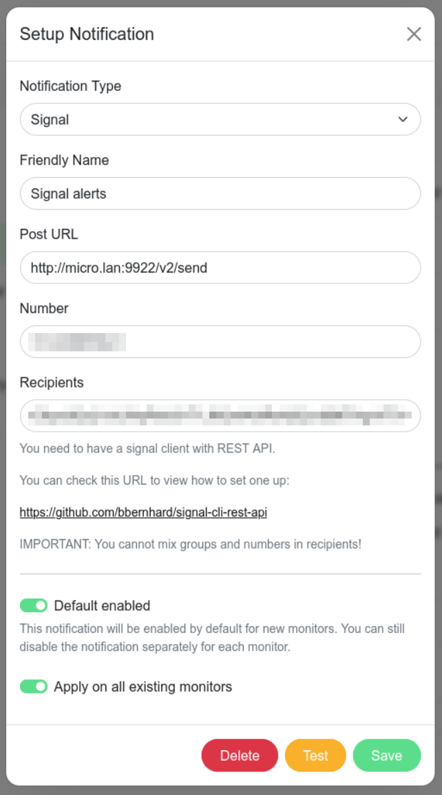

# Uptime Kuma Signal notifications

Uptime Kuma supports signal notifications natively.

Navigate to settings -> Notifications -> Setup notification, and then set:
Notification Type: Signal
Post URL: http://:/v2/send
Number:
Recipients:  or
Default enabled: On
Apply on all existing monitors: On (optionally)

Here is an example:

# Uptime Kuma configuration backups

Uptime Kuma's backup capability is deprecated as per this notificatioon in the UI:

  _Deprecated: Since a lot of features were added and this backup feature is a bit unmaintained, it cannot generate or restore a complete backup. Please backup the volume or the data folder (./data/) directly instead._

Kuma does not have a native supported backup/restore capability. The only way to backup the configuration is to back up the persistent data directory (`/app/data`) or the `kuma.db` database file.

### References

Github Issue: (Add import/export backup/restore for settings)[https://github.com/louislam/uptime-kuma/issues/6045]

Reddit discussion: (Database Backup & Disaster Recovery)[https://www.reddit.com/r/UptimeKuma/comments/10znk0j/database_backup_disaster_recovery/]
